# Gnomeworks Art-Style Visual Reference Gallery

**Purpose:** A frozen set of already-used game visuals for new sessions and future asset designers.  Read [the Art-Style Bible](../ART-STYLE-BIBLE.md) for rules.  These are **style examples only**, not pending implementation assets.

**Source of references:** Existing `assets/` files in this repository, selected to represent the user-provided art set.  The images below are copied from existing Git blobs so later changes to game assets do not silently change this gallery.  The high-resolution originals remain on Nathan's side.

## 1. Workshop machine: day and night

| Warm oak and brass (day) | Dark timber and amber brass (night) |
| --- | --- |
| 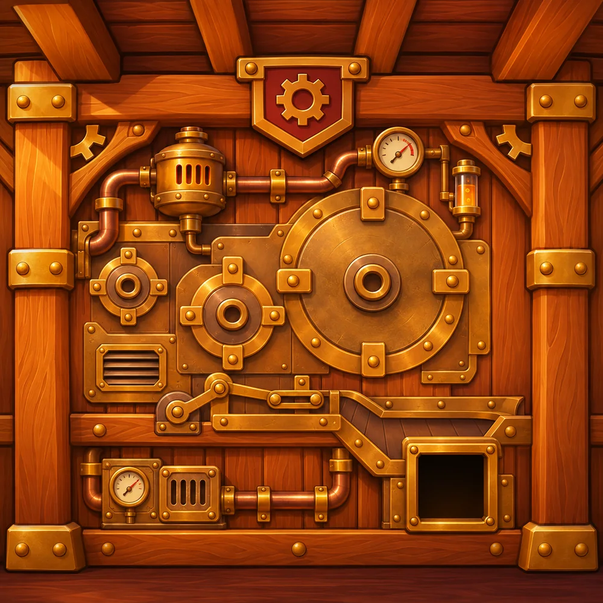 | 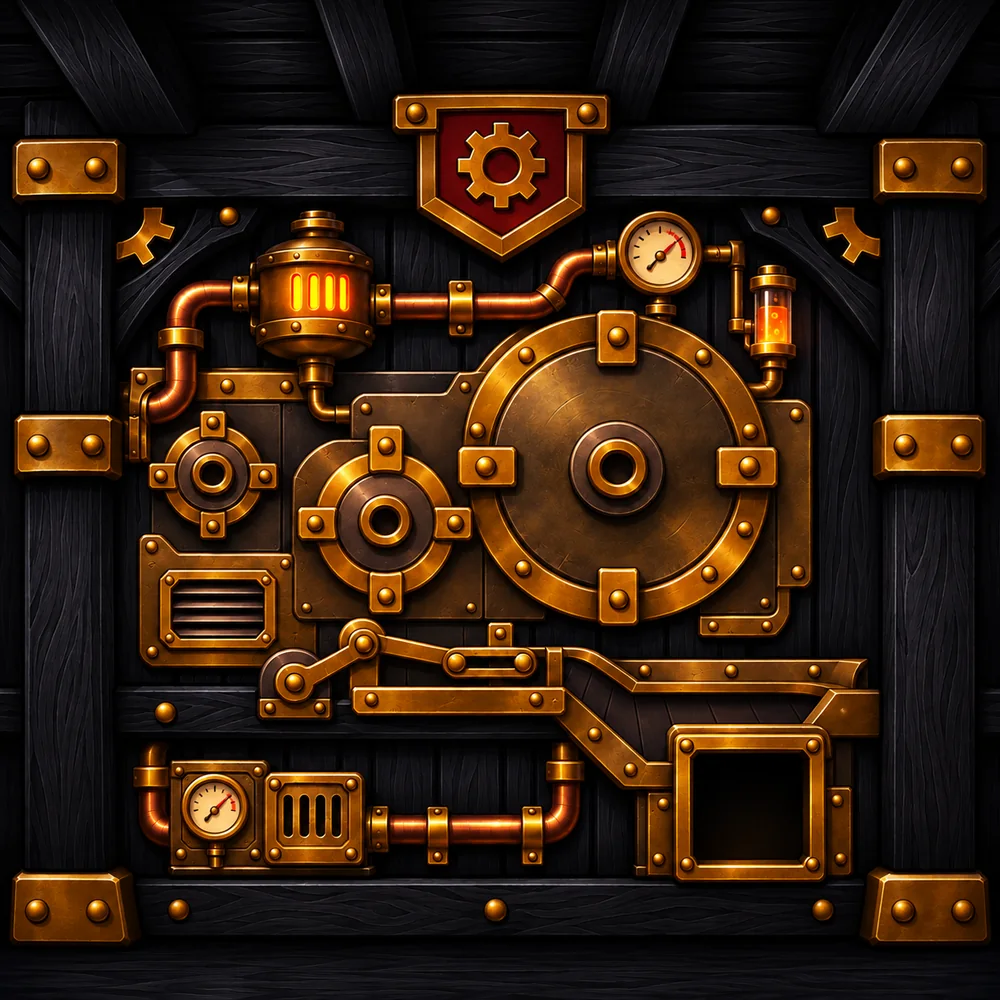 |

**Look for:** matched machine geometry; heavy rivets, plates and pipes; amber gauges; blue-black timber at night.  **Do not** change the underlying placement between paired backgrounds.

## 2. Character style and animation registration

| Worker resting | Worker operating | Wizard gear badge |
| --- | --- | --- |
| 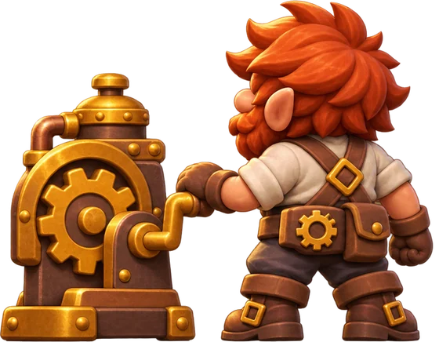 | 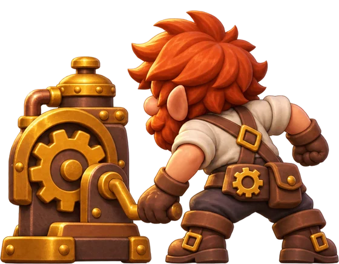 | 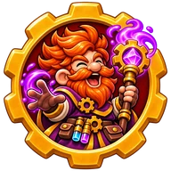 |

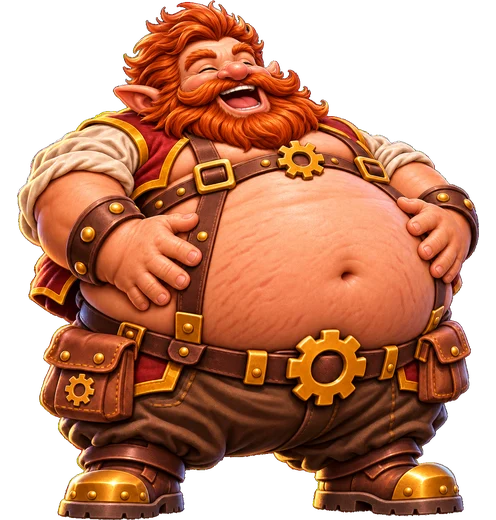

**Look for:** orange-red hair, broad ears, leather belts, stocky hands, stout proportions, aligned cranking poses and rich dimensional highlights.  The wizard badge is a close-up presentation with a large brass gear border; it is allowed to carry stronger magenta magic.

## 3. Tiny Monster collectible family

| Rabbit | Fox | Lizard |
| --- | --- | --- |
| 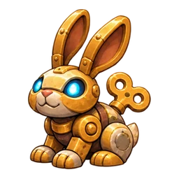 | 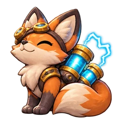 | 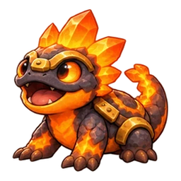 |

| Turtle | Mouse | Slime |
| --- | --- | --- |
| 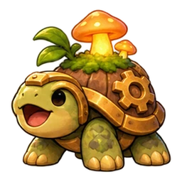 | 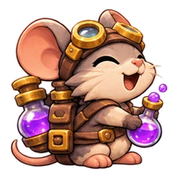 | 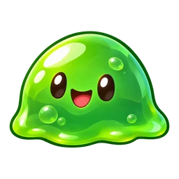 |

**Look for:** strong friendly shapes; large readable eyes; different organic/mechanical balances.  Tiny Monsters may be natural, furry, fungal, rocky or mechanical.  Their shared style comes from finish and proportions, not identical brass armor.

## 4. Branding and UI

| Day GNOMEWORKS sign | Night GNOMEWORKS sign |
| --- | --- |
| 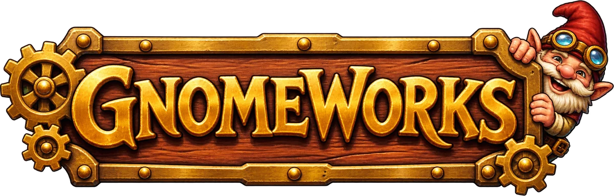 | 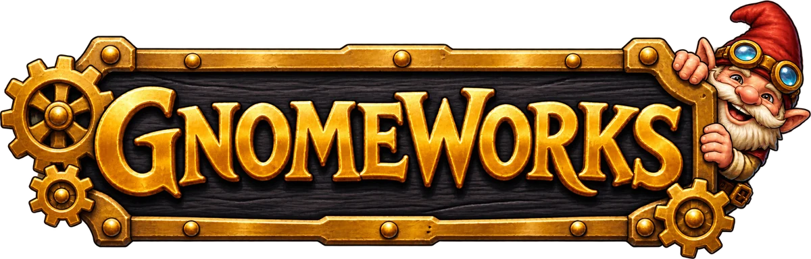 |

| Clipboard day | Clipboard night |
| --- | --- |
| 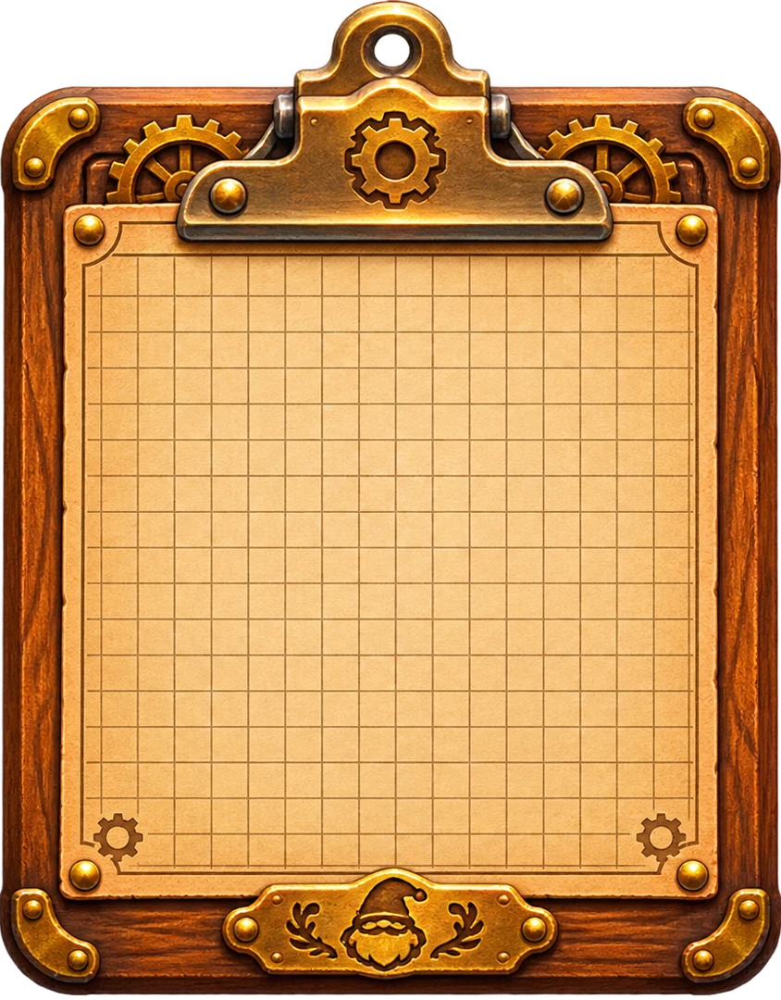 | 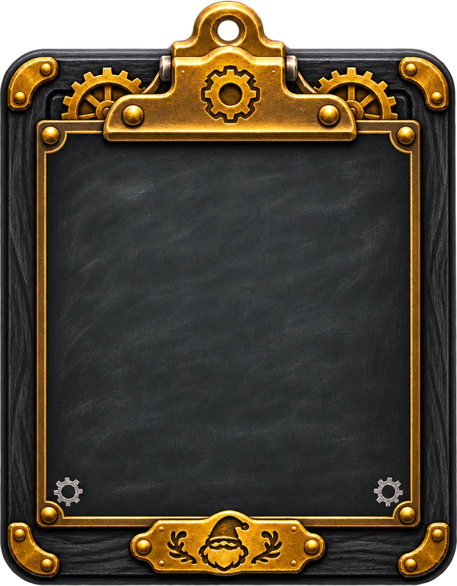 |

**Look for:** raised gold lettering, chunky rounded gold frames, wood/metal material separation, and identical geometric layouts across lighting modes.

## 5. Threat and encounter beasts

| Cockatrice | Boar |
| --- | --- |
| 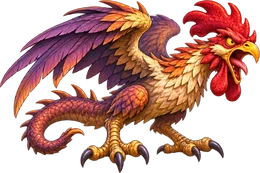 | 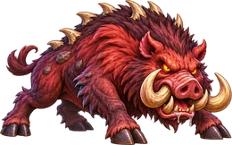 |

| Octopanther | Fishfrog |
| --- | --- |
| 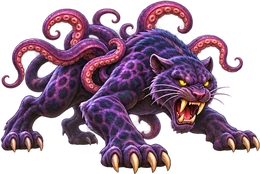 | 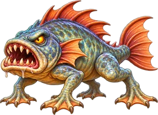 |

**Look for:** more dramatic pose, large teeth and claws, heightened natural texture and danger, but still colorful, shaped and illustrated.  This is the encounter variation of the house style.

## 6. Magical items

| Crystal pickaxe | Starry sword |
| --- | --- |
| 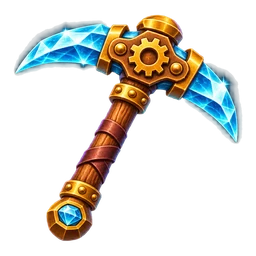 | 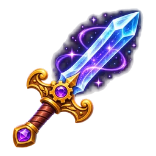 |

**Look for:** readability at item size, jewel facets, saturated blue/purple magic, brown handles, polished brass fittings and clean isolated silhouettes.

## 7. Exact snapshot manifest

| Frozen image | Original in deployed game | Purpose |
| --- | --- | --- |
| [`machine-day.webp`](references/machine-day.webp) | [`assets/bg/machine_wall.webp`](../../assets/bg/machine_wall.webp) | Day environment materials |
| [`machine-night.webp`](references/machine-night.webp) | [`assets/bg/machine_wall_night.webp`](../../assets/bg/machine_wall_night.webp) | Night counterpart |
| [`worker-rest.webp`](references/worker-rest.webp) | [`assets/crew/tiny_static.webp`](../../assets/crew/tiny_static.webp) | Static sprite alignment |
| [`worker-action.webp`](references/worker-action.webp) | [`assets/crew/tiny_action.webp`](../../assets/crew/tiny_action.webp) | Action sprite alignment |
| [`wizard-badge.webp`](references/wizard-badge.webp) | [`assets/icons/icon_wizard.webp`](../../assets/icons/icon_wizard.webp) | Icon / gear frame |
| [`monster-rabbit.webp`](references/monster-rabbit.webp) | [`assets/monsters/rabbit_normal.webp`](../../assets/monsters/rabbit_normal.webp) | Cute mechanical fauna |
| [`monster-fox.webp`](references/monster-fox.webp) | [`assets/monsters/fox_normal.webp`](../../assets/monsters/fox_normal.webp) | Magic / animal color |
| [`monster-lizard.webp`](references/monster-lizard.webp) | [`assets/monsters/lizard_normal.webp`](../../assets/monsters/lizard_normal.webp) | Elemental creature |
| [`monster-turtle.webp`](references/monster-turtle.webp) | [`assets/monsters/turtle_normal.webp`](../../assets/monsters/turtle_normal.webp) | Nature/fungus accents |
| [`monster-mouse.webp`](references/monster-mouse.webp) | [`assets/monsters/mouse_normal.webp`](../../assets/monsters/mouse_normal.webp) | Creature expression |
| [`monster-slime.webp`](references/monster-slime.webp) | [`assets/monsters/slime_normal.webp`](../../assets/monsters/slime_normal.webp) | Soft, organic creature |
| [`title-day.webp`](references/title-day.webp) | [`assets/ui/title.webp`](../../assets/ui/title.webp) | Brand sign day |
| [`title-night.webp`](references/title-night.webp) | [`assets/ui/title_night.webp`](../../assets/ui/title_night.webp) | Brand sign night |
| [`megagnome.webp`](references/megagnome.webp) | [`assets/mega/mega_idle.webp`](../../assets/mega/mega_idle.webp) | Exaggerated gnome anatomy |
| [`encounter-cockatrice.webp`](references/encounter-cockatrice.webp) | [`assets/mega/prey_cockatrice.webp`](../../assets/mega/prey_cockatrice.webp) | Dramatic feathers and claws |
| [`encounter-boar.webp`](references/encounter-boar.webp) | [`assets/mega/prey_boar.webp`](../../assets/mega/prey_boar.webp) | Large wild creature |
| [`encounter-octopanther.webp`](references/encounter-octopanther.webp) | [`assets/mega/prey_octopanther.webp`](../../assets/mega/prey_octopanther.webp) | Fantastical threat anatomy |
| [`encounter-fishfrog.webp`](references/encounter-fishfrog.webp) | [`assets/mega/prey_fishfrog.webp`](../../assets/mega/prey_fishfrog.webp) | Aquatic enemy |
| [`treasure-pickaxe.webp`](references/treasure-pickaxe.webp) | [`assets/treasures/diamond_pick.webp`](../../assets/treasures/diamond_pick.webp) | Tool / crystal treatment |
| [`treasure-sword.webp`](references/treasure-sword.webp) | [`assets/treasures/magic_sword.webp`](../../assets/treasures/magic_sword.webp) | Loot / purple magic |
| [`ui-clipboard-day.webp`](references/ui-clipboard-day.webp) | [`assets/ui/clipboard.webp`](../../assets/ui/clipboard.webp) | UI frame day |
| [`ui-clipboard-night.webp`](references/ui-clipboard-night.webp) | [`assets/ui/clipboard_night.webp`](../../assets/ui/clipboard_night.webp) | UI frame night |

**Snapshot policy:** Use these for *comparison*, not for creating new official content by cropping or changing the production files.  New assets remain in the design phase until Nathan approves the full set and passes it to Claudia.
